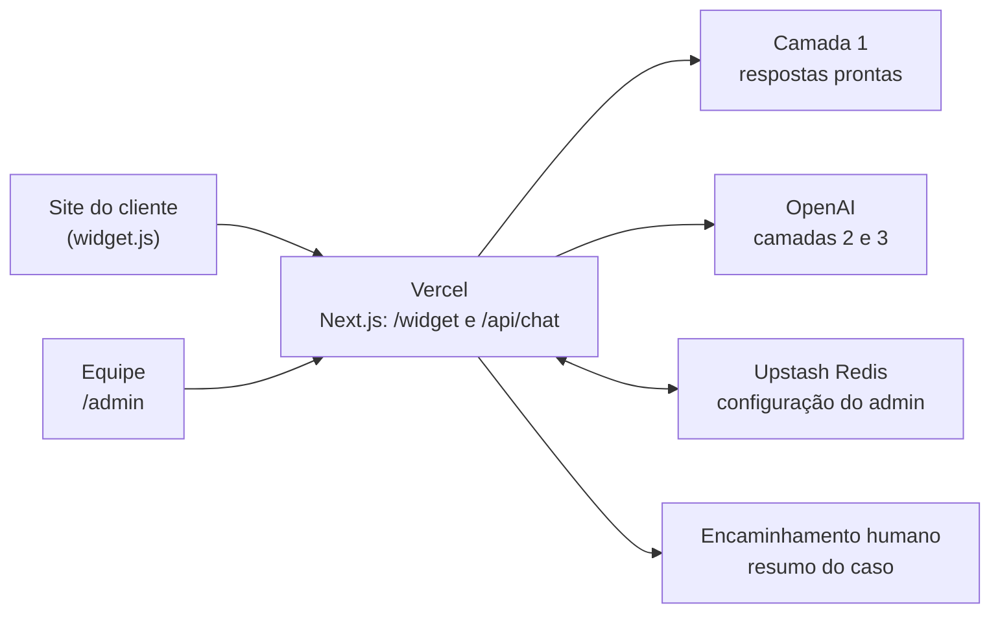

# Guia de implantação em ambiente real

Este guia descreve como levar o assistente do protótipo para a operação real de um site como o RealLeader: em que ordem, com quais cuidados, quem opera e como medir se está funcionando. Para instalar o projeto, veja o [README](../README.md); para colocar o chat num site, o [guia do widget](INSTALACAO-WIDGET.md).

## 1. Visão geral da arquitetura em produção



| Componente | Serviço | Papel | Plano para começar |
| --- | --- | --- | --- |
| Hospedagem e API | Vercel | Serve o widget, o chat e o admin | Hobby (gratuito) no piloto; Pro para uso comercial |
| LLM | OpenAI | Classificação e respostas com fontes | Pago por uso, com teto mensal |
| Banco da configuração | Upstash Redis | Guarda o que a equipe edita no admin | Gratuito |
| Código | GitHub | Versionamento; cada push publica | Gratuito |

> O plano Hobby da Vercel é para uso pessoal e não comercial. Para o atendimento real de uma empresa, use o plano Pro.

## 2. Plano de entrada em produção

A entrada é gradual: cada fase só começa quando a anterior atinge seu critério de passagem.

| Fase | Duração sugerida | O que acontece | Critério para passar à próxima |
| --- | --- | --- | --- |
| **0. Preparação** | 1 semana | Equipe revisa a base de conhecimento; empresa esclarece a política de reembolso para créditos; publica na Vercel com Upstash, senha do admin, teto de gasto e domínios autorizados | Base revisada e aprovada; checklist da seção 3 completo |
| **1. Piloto interno** | 1 a 2 semanas | Só a equipe usa, pelo link direto `/widget`, com 50 a 100 perguntas reais tiradas do histórico de atendimento | ≥ 90% das perguntas terminam na camada certa; nenhuma resposta com informação errada sobre preço ou política |
| **2. Piloto com clientes** | 2 a 4 semanas | Widget só nas páginas do RLPRESS e na página de ajuda | Taxa de encaminhamento estável; nenhuma reclamação de resposta errada; equipe consegue acompanhar os encaminhamentos |
| **3. Produção** | Contínuo | Widget em todo o site; rotina de manutenção da seção 5 | — |

**Como montar o teste da fase 1:**

1. Separe 50 a 100 mensagens reais do formulário de contato dos últimos meses (sem dados pessoais).
2. Para cada uma, anote a camada esperada (regras, LLM ou humano) e a resposta correta.
3. Envie todas pela aba **Testar o chat** do admin (ou pela API, em lote) e compare.
4. Cada erro vira um ajuste no admin: nova resposta pronta, novo trecho na base ou mudança no encaminhamento.
5. Repita até atingir o critério.

## 3. Checklist de go-live

Antes de colocar o widget no site para clientes:

**Segurança e custo**
- [ ] Chave da OpenAI exclusiva deste projeto, cadastrada só na Vercel (nunca no código)
- [ ] Teto de gasto mensal definido na OpenAI (*Settings → Limits*)
- [ ] `ADMIN_PASSWORD` forte e conhecida só pela equipe responsável
- [ ] `WIDGET_ALLOWED_ORIGINS` preenchida com os domínios do site
- [ ] Limite de mensagens por visitante configurado (ver seção 6)

**Conteúdo**
- [ ] Base de conhecimento revisada por quem responde o suporte hoje
- [ ] Trechos marcados como "Rascunho a validar" revisados ou desativados
- [ ] Política de reembolso para créditos definida pela empresa (até lá, a regra "reembolso vai para humano" fica ativa)
- [ ] Textos das respostas prontas aprovados

**Operação**
- [ ] Upstash conectado: o admin mostra "Salvando no Upstash Redis"
- [ ] Responsável definido para revisar o admin semanalmente (seção 5)
- [ ] Combinado como a equipe recebe os casos encaminhados (hoje o resumo aparece na tela; ver "próximos passos")
- [ ] Testes do [guia do widget](INSTALACAO-WIDGET.md#6-como-saber-se-funcionou) feitos no site real, no computador e no celular

## 4. Papéis

| Papel | Quem | Faz o quê |
| --- | --- | --- |
| Dono do conteúdo | Coordenação do suporte | Aprova textos da base e das respostas prontas; define o que vai para humano |
| Operador do admin | Analista de suporte | Ajusta respostas prontas e base no `/admin`; revisa os casos da semana |
| Responsável técnico | Desenvolvedor | Publicação, variáveis, chave da OpenAI, monitoramento de custo e erros |
| Atendimento humano | Equipe de suporte | Recebe os casos encaminhados (reembolso, bugs, parcerias) |

## 5. Operação do dia a dia

### Rotina semanal (30 minutos)

1. Revisar as perguntas que foram para humano por "baixa confiança" ou "fontes não cobrem".
2. Para cada uma que poderia ter sido respondida: acrescentar o trecho na **Base de conhecimento** ou criar uma **Resposta pronta**.
3. Testar as mudanças na aba **Testar o chat** e salvar.

### Quando algo muda no negócio

| Mudou | Onde atualizar |
| --- | --- |
| Preço, pacote ou validade | Resposta pronta correspondente **e** trecho da base |
| Novo produto ou recurso | Novo trecho na base; se houver pergunta frequente, nova resposta pronta |
| Nova política (ex.: reembolso de créditos) | Trecho da base; revisar a regra "Reembolso vai para humano" |
| Horário de atendimento | Resposta pronta "Horário e contato" e trecho `kb-atendimento` |

### Se algo der errado

| Situação | Ação imediata |
| --- | --- |
| Uma resposta pronta está errada | No admin, desmarque **Ativa** e salve: a mudança vale em segundos |
| Um trecho da base gera respostas erradas | Desative o trecho no admin |
| Uma edição no admin piorou tudo | Aba **Encaminhamento → Restaurar o padrão** |
| Um deploy novo quebrou o site | Na Vercel, em **Deployments**, escolha o deploy anterior e use **Instant Rollback** |
| Gasto da OpenAI subiu demais | O teto da OpenAI interrompe as chamadas; o chat continua com regras e encaminha o resto para humano |

## 6. Proteção de custo e abuso

O custo cresce com as mensagens que chegam às camadas 2 e 3. Quatro proteções, da mais simples à mais completa:

1. **Teto na OpenAI** (obrigatório): limita o prejuízo máximo do mês.
2. **Respostas prontas primeiro**: cada pergunta frequente resolvida na camada 1 é uma chamada de LLM a menos.
3. **Domínios autorizados** (`WIDGET_ALLOWED_ORIGINS`): impede que outros sites exibam o chat.
4. **Limite por visitante** (próximo passo de código): regra de *rate limiting* no Vercel Firewall, ou limite por IP com Upstash Ratelimit na rota `/api/chat` (por exemplo, 20 mensagens a cada 10 minutos).

### Estimativa de custo

Por mensagem que chega às camadas 2 e 3, o projeto faz duas chamadas pequenas ao modelo:

| Chamada | Tokens de entrada (aprox.) | Tokens de saída (aprox.) |
| --- | --- | --- |
| Classificação | 400 | 60 |
| Resposta com fontes | 1.500 | 200 |

```
custo mensal ≈ mensagens/mês × (1 − fração resolvida por regras)
               × (1.900 × preço por token de entrada + 260 × preço por token de saída)
```

Use os preços atuais do modelo escolhido na página de preços da OpenAI. Com modelos pequenos, o custo por mensagem costuma ficar em frações de centavo, mas confirme com a tabela vigente antes de apresentar valores.

## 7. Métricas

| Métrica | Como medir hoje | Meta inicial |
| --- | --- | --- |
| Resolução sem humano | % de mensagens que terminam nas camadas 1 ou 3 (painel "Distribuição") | ≥ 60% |
| Encaminhamento por baixa confiança | Casos com motivo "fontes não cobrem" | Cair semana a semana |
| Tempo de resposta | Campo `ms` da API | Regras < 50 ms; LLM < 5 s |
| Respostas erradas | Revisão por amostragem: 20 conversas por semana | Zero sobre preço e política |
| Cobertura de horário | Mensagens fora de seg–sex 9h–18h respondidas sem humano | Antes: 0%; depois: a fração resolvida |

## 8. Privacidade (LGPD)

- O protótipo **não armazena conversas**. O histórico existe só no navegador do visitante durante a sessão.
- As mensagens passam pela API da OpenAI para as camadas 2 e 3. Informe isso na política de privacidade do site e confira os termos atuais de uso de dados da API da OpenAI.
- O resumo para a equipe contém só a mensagem, a categoria, o produto e o idioma.
- Oriente no chat a não enviar dados sensíveis (cartão, senha). Se for gravar conversas para métricas, defina prazo de retenção e anonimização antes.

## 9. Próximos passos de produto

| Evolução | Ganho |
| --- | --- |
| Enviar o encaminhamento por e-mail ou abrir chamado num helpdesk | A equipe recebe o caso sem depender do cliente reenviar |
| Limite de mensagens por visitante | Proteção de custo |
| Botões 👍 / 👎 nas respostas | Métrica de satisfação e lista de respostas a revisar |
| Registro anônimo das conversas | Base para a revisão semanal e para métricas reais |
| Consulta ao saldo de créditos do cliente logado | Resolve "meu saldo zerou" sem humano |
